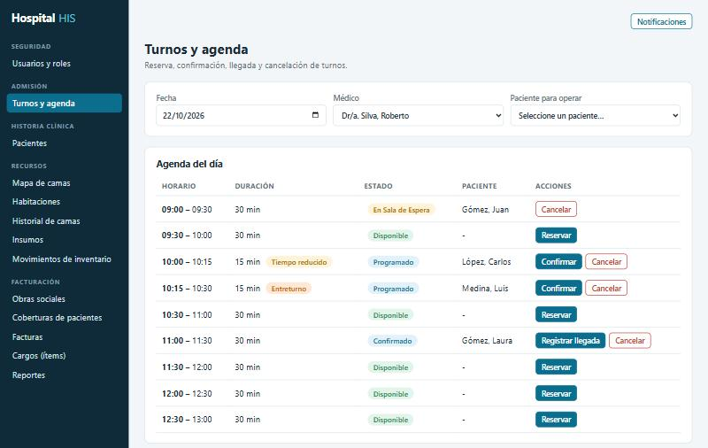
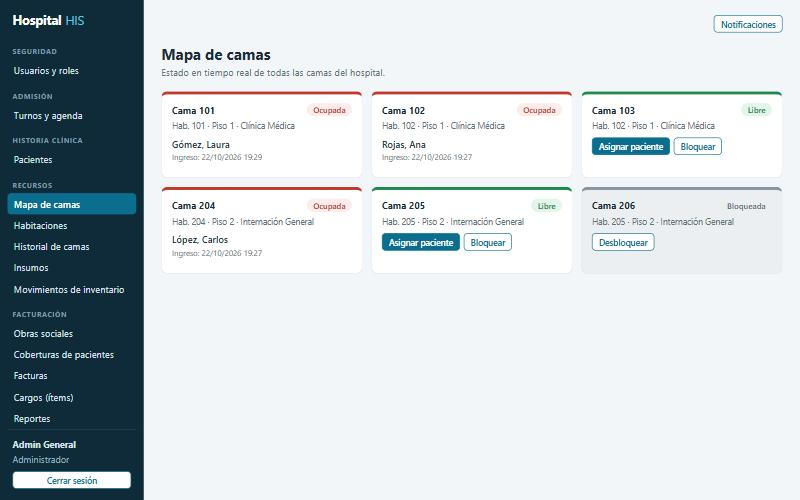
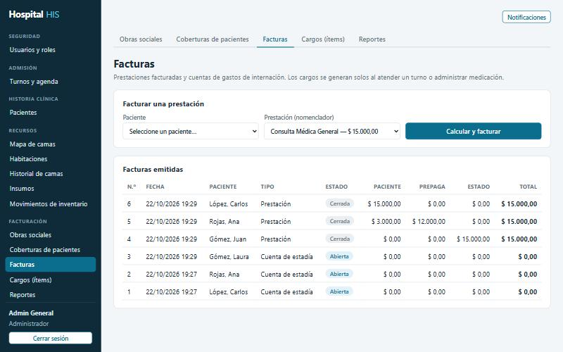
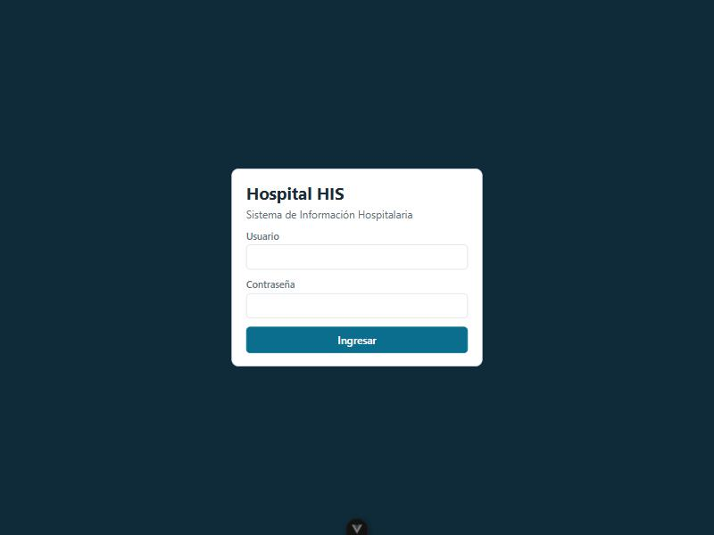
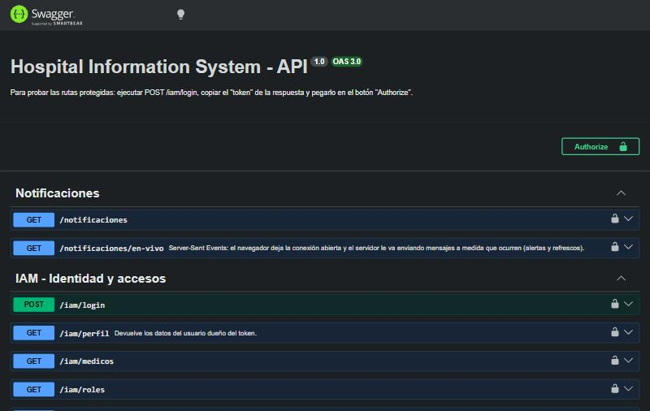

# Hospital Information System

Sistema de información hospitalaria desarrollado como Trabajo Práctico Integrador de
**Metodología de Sistemas**.

Cubre el recorrido de un paciente dentro del hospital: el turno o el ingreso por guardia,
la historia clínica, la internación en una cama, los cuidados de enfermería y la
facturación de lo que se le brindó.

- **Stack:** Vue 3 · NestJS · SQL Server
- **Arquitectura:** Diseño por Componentes



## Módulos

| Módulo | Qué resuelve |
|---|---|
| **Identidad y Accesos (IAM)** | Inicio de sesión con JWT, 5 roles (Administrador, Médico, Enfermero, Recepcionista, Paciente) y permisos por rol en cada ruta |
| **Admisión y Turnos** | Agenda médica, reserva segura de turnos (bloqueo pesimista), entreturnos, lista de espera, estados del turno (patrón State) y triaje de guardia con cola de prioridad |
| **Historia Clínica (HCE)** | Ficha del paciente, alergias, antecedentes familiares, evoluciones médicas inmutables y estudios |
| **Atención y Enfermería** | Signos vitales con alertas fuera de rango, administración de medicación con margen horario y protocolos de atención generados con el patrón Builder |
| **Recursos y Camas** | Mapa de camas en tiempo real, asignación segura (bloqueo optimista), máquina de estados de la cama e inventario con descuento atómico |
| **Facturación** | Cálculo de costos según la cobertura (patrón Strategy), cargos automáticos por eventos y reportes administrativos |

### Características destacadas

- **Control de concurrencia:** dos recepcionistas no pueden reservar el mismo turno ni
  asignar la misma cama, aunque lo intenten en el mismo milisegundo.
- **Integración por eventos:** al administrar una medicación, Inventario descuenta el stock
  y Facturación genera el cargo sin que Enfermería los conozca. Los tres registros quedan
  vinculados por el mismo ID de evento.
- **Tiempo real:** las alertas (Código Rojo, signos vitales fuera de rango) y los cambios
  en el mapa de camas llegan al instante a las pantallas abiertas (Server-Sent Events).
- **Documentación de la API** con Swagger.
- **Pruebas automáticas** de los patrones y de cada escenario de las historias de usuario.

## Capturas

| | |
|---|---|
|  |  |
| **Mapa de camas** — estado de cada cama, actualizado en tiempo real | **Facturación** — el mismo costo repartido según la cobertura |
|  |  |
| **Inicio de sesión** | **Documentación de la API (Swagger)** |

## Estructura del proyecto

```
├── backend/                 API REST en NestJS
│   ├── src/
│   │   ├── iam/  hce/  admision/  enfermeria/  recursos/  facturacion/   ← un módulo por componente
│   │   ├── shared/          eventos y notificaciones en tiempo real
│   │   └── main.ts          arranque, validación global y Swagger
│   ├── scripts/crear-bd.mjs crea la base de datos
│   └── test/                pruebas de punta a punta de las historias de usuario
├── frontend/                Aplicación web en Vue 3
│   └── src/
│       ├── modules/         las mismas 6 carpetas que el backend (rutas, servicios, vistas)
│       ├── shared/          componentes, composables, stores y servicios comunes
│       └── router/          rutas y control de acceso por rol
└── docs/
    ├── COMO-PROBAR.md       instalación y recorrido de prueba paso a paso
    ├── modelo-datos/        scripts SQL: tablas y datos iniciales
    └── capturas/
```

## Requisitos

- Node.js 22.18 o superior
- SQL Server (Express alcanza) con el **ODBC Driver 17 for SQL Server**

## Instalación y ejecución

```bash
# 1) Backend
cd backend
npm install
copy .env.example .env        # revisar DB_SERVIDOR y JWT_SECRETO
npm run db:crear              # crea la base HospitalDB con datos de prueba
npm run start:dev             # http://localhost:3000

# 2) Frontend (en otra terminal)
cd frontend
npm install
npm run dev                   # http://localhost:5173
```

El paso a paso completo, con solución de problemas y un recorrido por todas las historias
de usuario, está en **[docs/COMO-PROBAR.md](docs/COMO-PROBAR.md)**.

### Usuarios de prueba

Todos con la contraseña `Hospital123`:

| Usuario | Rol |
|---|---|
| `admin` | Administrador |
| `dsilva` | Médico |
| `mtorres` | Enfermero |
| `recepcion` | Recepcionista |
| `clopez` | Paciente |

## Documentación de la API

Con el backend corriendo: **http://localhost:3000/api/docs**

Para probar las rutas protegidas, ejecutar `POST /iam/login`, copiar el `token` de la
respuesta y pegarlo en el botón **Authorize**.

## Pruebas

```bash
cd backend
npm test            # pruebas unitarias de los patrones (State, Builder, Strategy) y la máquina de estados
npm run test:e2e    # historias de usuario de punta a punta (requiere db:crear + backend corriendo)
```

## Base de datos

- [Script de creación de tablas](docs/modelo-datos/01-crear-base-de-datos.sql)
- [Datos iniciales](docs/modelo-datos/02-datos-iniciales.sql)
